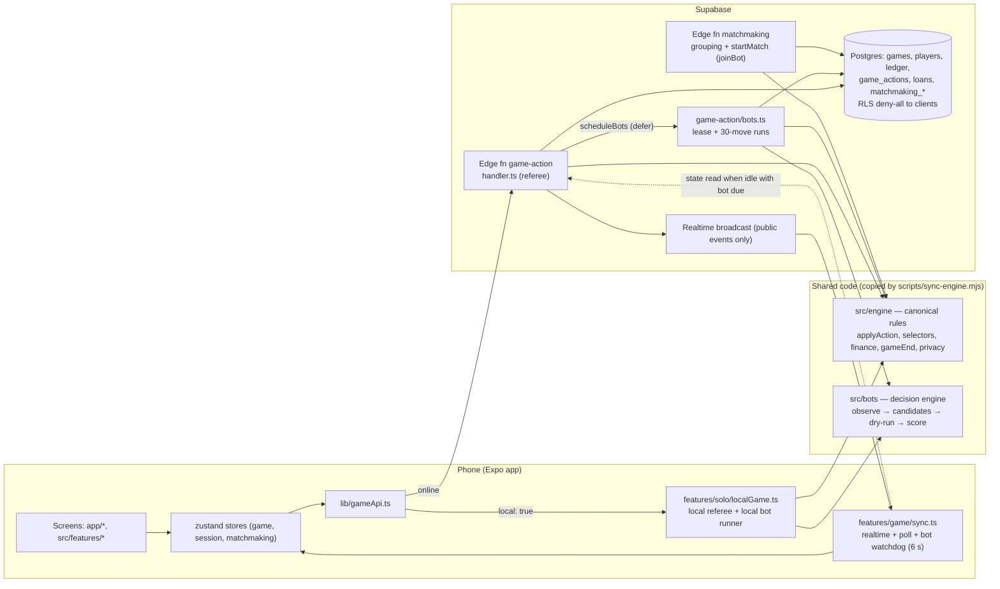

# Clash of Capitals — System, Bot and Loan Audit

*Audit date: 2026-10-16 · Revision audited: `09569938e27ebce7a15cdda9a9050348ca9e237d` ("bot system v1") on `main`, working tree clean.*
*Audit only. No source, test, migration, configuration or generated file was changed. This report is the only new file in the repository. Probe tests, a scratch Postgres cluster and simulation output lived in a temporary scratch directory outside the repository and were not committed.*

---

## A. Executive summary

**Overall status.** The codebase is in good shape. Every safe test suite was run and all of them pass. That is 1,496 engine/bot/feature tests, 445 server integration tests against a freshly migrated Postgres, and 825 UI tests. Typecheck and lint are clean. The engine is the single source of truth for both modes. Its server copy is byte-identical to `src/`, and a test enforces that.

**Most significant working capabilities (verified):**
- One pure engine (`src/engine`) runs on the device (solo), on the server (Edge Function) and in simulations. The server applies every action under a row lock, in one transaction, with idempotent action ids.
- The bot system is complete enough to play whole games. Across 152 seeded games run during this audit (about 120,000 bot actions), the engine refused **zero** bot actions, no game got stuck, every hosted game finished, and no ledger, property or player invariant was violated. The calibration run reproduced the README's published tables exactly, so behaviour is deterministic.
- Bot seats cannot be impersonated. A bot seat has no token hash and no account. The database refuses to change a seat's kind, and `authenticate`, `claim_seat`, quick chat and voice all refuse a bot seat (server tests pass).
- Bots read only what the server would send to their own phone (`observe` → `redactObjectives` → `redactEndVote` → `redactFinances`). They never read hidden finances, at any difficulty.
- The Capital loan system matches the earlier brief on every numeric value checked: products, rates, terms, limits, credit bands and events, pooled collateral at 80%, buildings at 50%, outstanding-principal interest, the default trigger, refinancing and final net worth. It has extensive engine tests.

**Highest-risk defects:**
1. **BOT-001 (P2):** bots do not bid in a *resale* auction (one a person starts) when only timers drive them. In solo play, a resale with no further input from the person always ends unsold. This was reproduced with the real `localGame`. Online, it depends on a phone's watchdog firing inside a 9-second window.
2. **BOT-002 / BOT-003 (P2, balance):** the personality and difficulty labels don't match outcomes. The Banker ("stability first") goes bankrupt most often in Classic (29–33%) and wins 0–8%. In Classic, Easy beats Normal. In Capital, Hard trails Normal and goes bankrupt most.
3. **BOT-004 (P2, product):** opt-in bot filling never helps a player searching alone. A table still needs at least two people before bots are added.
4. **BOT-005 (P2, unverified risk):** the online bot runner has never run on the Edge runtime. It chains itself inside `EdgeRuntime.waitUntil`, and its CPU and wall-clock behaviour there is unmeasured.

**Bot-system maturity:** *functional and stable, strategically uneven, not yet deployed.* Legal-action coverage is complete for every phase it is designed to handle. Integration with private rooms, matchmaking and solo play exists and is tested. Calibration and timer-driven paths are the weak points.

**Economic correctness risks:** no corruption path was found. The open items are product decisions, not defects. For example, the Personal loan is never cheaper than the Flexible loan, bots never buy insurance, and the default borrowing limit hides the larger products.

**Multiplayer and data-integrity risks:** low for correctness, because of row locks, one transaction per move, deterministic bot action ids and deny-all RLS. They are moderate for liveness: bots wake late after matchmaking starts and after resale countdowns, and Edge background limits are unknown.

**Most important missing tests:** timer-driven bot wake-ups (resale countdown, solo and server); the deferred and chained runner on the real Edge/Deno runtime; and simulations with a person at the table using person-only actions.

**Recommended immediate next action:** fix BOT-001 (wake bots when a resale's bidding opens, on both device and server) and add the test that would have caught it. Then run the Edge staging check (BOT-005) before deploying `20261025000000_bot_players.sql` and the functions.

**Ratings by dimension** (judgement; the basis is given in the sections cited):

| Dimension | Rating | Basis |
|---|---|---|
| Functionality | Strong | All modes, loans, bots, solo, private and public paths exist (§C) |
| Correctness (engine/economy) | Strong | 0 invariant violations, strong engine tests, no corruption found (§G, §E) |
| Bot strategic quality | Fair | Legal and stable, but outcomes don't follow the labels (§D.7) |
| Test evidence | Strong for engine/server, weak for timers and Edge runtime | §G, TEST-001…005 |
| Security | Strong | Deny-all RLS, token-less bot seats, redacted observations (§D.10) |
| Operational readiness (online bots) | Not ready | Not deployed; Edge behaviour unmeasured (BOT-005) |

---

## B. Baseline and environment

### B.1 Repository state
- Branch `main`, tracking `origin/main`, **clean**, HEAD `0956993` (bot system v1).
- Recent relevant commits: `e900508` (major economic rules change) → `e8d12e0` (Chance roll-11 becomes a bank reward; debt rules hardened) → `37dffa5` (Capital loan system: products, pooled collateral, refinancing) → `8a38376` (loan system improved) → `0956993` (bot system v1: 75 files, `src/bots/*`, `game-action/bots.ts`, migration `20261025000000_bot_players.sql`, solo play, UI).
- Expo SDK 57, React Native 0.86, TypeScript 6.0. Routes live in `app/` (not `src/app/` as `AGENTS.md` describes, which is a documentation mismatch, P3).

### B.2 Commands run (results in §G)

| Command | Result |
|---|---|
| `npx vitest run tests/engine tests/learning tests/account tests/social tests/matchmaking tests/voice tests/bots` | 49 files passed, 1 skipped (calibration, opt-in); **1,496 passed, 1 skipped** (2 min 10 s) |
| `DATABASE_URL=… npx vitest run tests/server` (scratch Postgres 18, all 22 migrations applied cleanly) | **14 files, 445/445 passed** (2 min 6 s) |
| `npx jest --testTimeout=30000` (run alone) | **34 suites, 825/825 passed** (1 min 12 s) |
| `npx tsc --noEmit` | exit 0 |
| `npx expo lint` | exit 0, no warnings |
| `CALIBRATE=… npx vitest run tests/bots/calibration.test.ts` | 120 games, all finished; identical to README tables |
| Audit probes (scratch, see §G.3) | 8 probe tests, 32 further seeded games |

**Not run:** `npm run test:e2e` (Maestro needs a device or emulator), `sync:engine` (it would overwrite generated files; verified with a read-only `diff -r` instead), `deploy:*` (prohibited), `expo-doctor` (not needed for conclusions). The live Supabase schema and Edge runtime were **not** inspected; there is no safe connection, and the README states the bot migration and functions are not deployed.

**Pre-existing failures:** none. A server test that earlier notes called failing on clean HEAD ("catch-up payment racing the default") now passes; it was changed in `8a38376`.

---

## C. Architecture

### C.1 Map

- **Verified by code and tests:** every box and arrow above.
- **Not verified in a real runtime:** `defer`, which is `setTimeout` plus `EdgeRuntime.waitUntil` (`supabase/functions/game-action/index.ts:39-43`), and realtime delivery. Tests run the handler in Node with `defer` either absent or synchronous.
- **Proposed, not built:** disconnect takeover (README: not implemented; no server-side seat presence).

### C.2 Sources of truth
- **Rules and money:** `src/engine/reducer.ts` (`applyAction`), with mode branches into `intermediateEngine.ts`, `insurance.ts` and `estate.ts`. Pure: it clones its input and takes `now`, `random` and `newId` from its context.
- **Net worth and the winner:** `selectors.ts` `balanceSheet` (l. 238) and `rankStandings` (l. 281).
- **Duration clock:** `gameEnd.ts` (`durationLimit`, `calendarYear`), plus the Capital `gameClock`.
- **Server copy:** `supabase/functions/_shared/{engine,bots}`. `diff -rq` shows only the generated `README.md` differs, and `tests/engine/sourceSync.test.ts` enforces this. Server and client therefore run identical logic, **provided** `npm run sync:engine` is run before deploy. `deploy:functions` does this.
- **Persistence:** the game state is decomposed into tables (`db.ts` `loadState` and `persistResult`), with an append-only ledger (`transactions`) and an action log (`game_actions`, primary key on `action_id`).

### C.3 Game modes
- `classic` ("Classic") and `intermediate` ("Capital Mode" in older documents). Both are hosted, meaning they have a duration and end votes. A matchmade game (`startHostlessGame`) has no duration and ends when one player is left, or with `NO_PEOPLE_LEFT` when only bots remain.

---

## D. Bot-system report

### D.1 Architecture and call path
`runner.nextBotMove(state)` takes bots in seat order, starting from the bot whose turn it is. For each bot it calls `decideFor`, which runs `observe` (`observation.ts`) and then `policy.decide`. The decision steps are: an open vote, then a crisis bill, then an undo answer, then a trade offer, then an auction, then loan obligations, then the bot's own turn phase. Candidates are dry-run through the real `applyAction` (`engineAccess.dryRun`, using `random = 0.5`) and scored with `valuation.assess` deltas weighted by personality (`scoring.evaluate`). The chosen action goes back to the caller, which applies it authoritatively.

Callers: the server (`game-action/bots.ts` `runBots`), the device (`localGame.ts` `step`) and the simulator (`tests/bots/simulator.ts`). All three use the same `nextBotMove`.

### D.2 Capability matrix

| Capability | Source | Implemented | Tested | Integrated | Observed result | Issues |
|---|---|---|---|---|---|---|
| Bot seat model | `engine/botSeat.ts`, `PlayerState.bot` | Yes | engine, server, UI | All destinations | — | — |
| Observation / redaction | `bots/observation.ts` | Yes | `core.test` "information boundary" | All | Decisions don't change with hidden opponent cash | Cash estimate ignores rent and loans (documented) |
| Candidates via engine dry-run | `engineAccess.ts`, `scoring.ts` | Yes | core | All | 0 refusals in about 120k actions | — |
| Valuation (7 dimensions) | `valuation.ts` | Yes | core (group not double-counted, etc.) | All | Sensible; see D.6 | BOT-012 |
| Movement model, exact dice | `dice.ts`, `movement.ts` | Yes | core (distribution, MC convergence) | All | Dice exact; MC CV 5.5% (256), 2.3% (1024) | — |
| Horizon | `horizon.ts` | Yes | core (5 tests) | All | Matches engine clock | — |
| Reserve `R_target` | `valuation.ts` 414-571 | Yes | core | All | — | — |
| Auctions (bank) | `auction.ts` | Yes | core | All | Bids up to computed max | BOT-010 |
| Auctions (resale) | same | Yes (logic) | **No** | **Broken when timer-driven** | 0 bids, unsold | **BOT-001** |
| Trades (respond, counter, propose, cancel) | `trading.ts` | Yes | core | All | About 5% of bot↔bot proposals accepted | BOT-007 |
| Loans (Classic, Capital), recovery | `finance.ts` | Yes | core | All | Loans used; recovery works | — |
| Insurance | `finance.ts` 582-593 | Yes | Partially | All | **Never chosen** (0 of 4,984 Capital actions) | BOT-008 |
| Construction with hurdle | `policy.ts` 398-438 | Yes | core | All | — | — |
| Jail choice | `policy.ts` 366 | Yes | core | All | Mostly stays | — |
| End votes | `policy.ts` 214 | Yes | core | All | — | — |
| Undo answers | `policy.ts` 187 | Yes | core | All | — | — |
| Server runner (lease, ids, retries) | `game-action/bots.ts` | Yes | server (4 tests) | Online | Passes | BOT-005, BOT-006 |
| Matchmaking bot fill | migration `20261025…`, `matchmaking/handler.ts` | Yes | server (3 tests) | Public | Fills a 2–3 person table up to 4 | BOT-004 |
| Private-room bots | `ADD_BOT`, `LobbyView` | Yes | engine, server, UI | Private | Host only, lobby only | — |
| Solo play | `localGame.ts`, `app/solo.tsx` | Yes | `solo.test`, UI | Solo | Plays full games | BOT-001, BOT-009 |
| Disconnect takeover | — | **No** (by design, documented) | — | — | — | Needs server presence first |
| Decision explanations | `BotDecision.reason` | Yes | core | Server stores `kind` only | — | Reasons are not persisted (fine) |

**Can a bot finish a whole game?** Yes. All 120 calibration games and all 32 audit games (hosted, both modes, all difficulties and personalities) finished. Matchmade bot-only games are run only to a 2,500-action bound in the suite, by design.

### D.3 Personalities: do they differ?
They do. In a paired probe (same state, sweeping cash), the lowest cash at which a bot still buys the property it landed on was:

| Classic, Normal | Investor | Banker | Deal Maker | Opportunist |
|---|---:|---:|---:|---:|
| Mumbai (₹8,500) | ₹11,000 | ₹13,500 | ₹12,500 | ₹10,500 |
| Delhi | ₹8,500 | ₹10,500 | ₹10,000 | ₹8,500 |
| Jaipur | ₹7,000 | ₹8,000 | ₹8,000 | ₹7,500 |

The Banker always needs the most cash and the Opportunist the least, which is the intended ordering. In Capital the spread is wider. On Mumbai, the Opportunist buys from ₹8,500 and the Banker from ₹12,500. The Banker **never** buys Jaipur at any cash level up to ₹25,000.

Thresholds near the ₹120 minimum-improvement bar move by about ±₹500 between game seeds. That is Monte Carlo noise (scores varied ₹115–₹134 for the same decision across seeds), not a cash effect.

**Where they barely differ:** auction ceilings. The maximum bid on Mumbai at ₹25,000 cash varied by at most ₹400 across personalities at each difficulty (BOT-010).

**Trading volume follows the design.** In 24 games, Deal Makers proposed 159 trades, Opportunists 91, Investors 74 and Bankers 43.

### D.4 Difficulties
- Implemented differences (`config.ts` `DIFFICULTY_TUNING`): the movement model (exact next roll vs Monte Carlo 256 / 1,024), the plan length (8 / 14 / 20 turns), the early-end discount, Easy's fixed ±20% valuation error, the rivalry weight, trade proactivity and counteroffers, jump bids and Hard's denial value.
- **No privilege.** All difficulties use the same `observe`. Hard reads no hidden data. Verified by code and by the `core.test` information-boundary tests.
- Simulation budgets are as proposed: 256 and 1,024 simulations per player per decision, cached on position, jail, skip, horizon and seed. Measured cold landing-model cost on this laptop for 4 players: Easy 0.06 ms, Normal 1.9 ms, Hard 9.9 ms. The longest single decision seen in 24 games was 44 ms.
- **Outcomes are not ordered by difficulty** (BOT-003). Classic: Easy 25% wins, Normal 19%, Hard 31%. Capital: Easy 28%, Normal 28%, Hard 19% with 25% bankrupt. Normal and Hard decline cheap Capital properties at any cash (Agra and Jaipur for the Investor), while Easy buys them.

### D.5 Legal-action and phase coverage
Every phase in `policy.decide` was checked against the engine's actions (README coverage table, confirmed in code):
- `AWAITING_ROLL` (roll, or jail fine vs stay), `AWAITING_DECISION` (buy, insured buy, funded buy, decline), `AWAITING_PAYMENT` (pay, raise money least-harm first, or bankruptcy only when allowed), `AWAITING_CARD` (legacy), `TURN_COMPLETE` (build, unmortgage, repay, insure, renew, stale-offer cancel, propose, end turn).
- Out-of-turn moves: votes, crisis bills, undo answers, trade answers, auctions (bid, pass, close after the deadline), and loan installments.
- A refused action is excluded for that state version and the bot decides again. If everything is excluded it returns `NO_LEGAL_ACTION` rather than looping.
- The bot stops when the game is not `ACTIVE`.
- **Gap:** the resale countdown (BOT-001). That phase is not mishandled in its logic; the bot is simply never woken during it.

### D.6 Valuation, rent and horizon
- Rent always comes from the engine's `computeRent`. `expectedRentFor` uses the fact that rent is linear in the dice total, which is exact.
- Group value is income with multipliers minus standalone income, so it is never double-counted (test).
- Terminal value is undiscounted at book value. This matches `balanceSheet`, which counts property at deed or market value and buildings at 100% of cost.
- Horizon: `S_remaining = max(0, durationLimit × N_start × 36 − S_used)` (`horizon.ts:253-260`), with turns ≈ S / (active × 7). Matchmade games use a 2-year planning horizon that affects valuation only. Verified by 5 tests.
- Movement mirrors the engine's card-by-dice-total rule, jail and Rest House. It assumes a jailed opponent stays with 50% probability (unvalidated). Mortgaged properties earn 0 through `computeRent`.
- The construction hurdle is `rent gain + terminal value ≥ hurdle × cost` (1.2–1.3 by personality, against the brief's 1.25). Because terminal value is 100% of cost, the hurdle reduces to "rent gain ≥ 0.2–0.3 × cost over the plan". That is consistent with scoring, but it means construction is cheap in score terms (see prior audit M5).
- BOT-012: the Capital valuation subtracts liabilities, which already include interest accrued this loan year, and also the full scheduled interest of the next installment. The accrued part is counted twice. This is a small bias against borrowing.

### D.7 Seeded simulation results (this audit)
120 calibration games (24 per row, 4 bots, hosted, 5 years). The results are **identical** to the README tables:

| Row | Finished | Refused | ms/decision | Notable |
|---|---|---|---|---|
| Classic · Normal · personalities | 24/24 | 0 / 18,110 | 2.6 | Banker 8% wins, 33% bankrupt |
| Classic · Hard · personalities | 24/24 | 0 / 17,569 | 5.5 | Banker 0% wins, 29% bankrupt; Deal Maker 46% |
| Capital · Normal · personalities | 24/24 | 0 / 16,338 | 4.0 | Opportunist 8% wins, 42% bankrupt |
| Classic · difficulties | 24/24 | 0 / 17,961 | 2.9 | Easy 25 / Normal 19 / Hard 31% |
| Capital · difficulties | 24/24 | 0 / 19,266 | 3.9 | Easy 28 / Normal 28 / Hard 19% |

There were 24 more games (8 each: Classic Normal, Capital Normal, Classic Hard) with 0 refused, 0 stuck, 0 violations and a maximum decision of 44 ms. Bots proposed 367 trades and accepted 19 (about 5%). They never insured anything. Jail: 449 stays vs 16 fines paid.

A further 32 games compared runs with and without the per-turn management cap: identical results, with at most 9 same-turn actions.

**Limitations:** all-bot tables only. With 24 games per row, a difference of about ±10 points is within noise. No person-only actions occur (resale listing, gifts, undo or vote requests).

### D.8 Online execution integrity (verified)
- Bots act only for seats the database marks as bots. There is no token, `authenticate` refuses a bot seat (`handler.ts:125-130`), and trigger `players_seat_kind_guard` freezes a seat's kind.
- Each move runs in its own transaction: lock the game, load the state, decide, apply, persist, then insert into `game_actions` with the deterministic id `SHA-256(game|version|seat|action)` (`bots.ts:69-74`). A duplicate is refused by the primary key.
- A 30-second lease (`games.bot_runner_until`) and a 30-move budget per run. The runner stops when the game is paused, finished or waiting on a timer. Server tests cover the lease, duplicates, the paused, finished and lobby cases, and the hidden-cash snapshot.
- Solo play cannot reach the server. `gameApi` routes a `local` session to `localGame`. Chat, voice, social and session persistence all skip local sessions (`voice.ts`, `SocialHost.tsx`, `sessionStore.ts`, `leaveGame.ts`).

### D.9 Destinations
- **Public matchmaking:** opt-in for solo tickets only (`BOTS_SOLO_ONLY` for parties). Bots are added only when every ticket allows them and `bot_fill_enabled` is on. Bot seats fill up to `target_players` (≤ 8, ≤ 6 bots). The count is fixed on the reservation and shown at ready-up as consent. The difficulty comes from a server setting and personalities rotate. The old two-argument RPC still works. **But a lone searcher never gets a table** (BOT-004), and the first bot move after start waits for a phone read (BOT-006).
- **Private rooms:** `ADD_BOT` is host-only and lobby-only, within table size. Bots are removed with `REMOVE_PLAYER`. The host role never passes to a bot. A lobby with only bots closes. Tested in the engine, server and UI.
- **Solo:** 1–7 bots, a difficulty, a personality or Mixed, and full game settings. It runs the same engine and bots with the same redaction. Kept in memory only (documented). Defects: BOT-001; the cap is not passed (BOT-009, latent).
- **Disconnect takeover:** not implemented. This is correctly documented and is not a defect.

### D.10 Security and privacy
- RLS is enabled with **all privileges revoked** on game tables for `anon` and `authenticated`. Clients reach game data only through the Edge Function, which shapes each snapshot per player (`loadSnapshot`). Broadcasts carry only `publicEvents`.
- Token comparisons elsewhere (`quickChat.ts:41`, `voice-token/handler.ts:134`) refuse a `null` hash. `claim_seat` was fixed to refuse a missing hash explicitly.
- No secrets were found in client code. The service key is used only server-side (`game-action/index.ts`).
- No new findings in this area.

### D.11 Bot-specific blockers before relying on online bots
1. BOT-001: resale wake-up.
2. BOT-005: measure the Edge runtime and decide whether the runner needs a durable trigger, such as a cron or queue tick for idle games with a bot due.
3. Deploy in the order the README gives (migration first). It has not been deployed yet.

---

## E. Loan-system compliance matrix (Capital Mode)

Reference: the earlier "Complete Loan System Implementation" brief, as restated in the audit request. Status key: **V** = implemented and verified (code plus a meaningful test); **U** = implemented, unverified; **P** = partial or inconsistent; **N** = not implemented; **D** = needs a product-owner decision.

| Item | Proposed | Actual (source) | Status |
|---|---|---|---|
| Emergency | 18%, 1 y, ₹10k–20k, unsecured | 18%, 1 y, max ₹20,000 (`intermediateConfig.ts:274`) | V |
| Personal | 13%, 3 y, ₹10k–30k | Same | V |
| Secured | 7%, 3 y, ₹10k–50k, collateral | Same | V |
| Long-term | 11%, 5 y, ₹10k–40k | Same | V |
| Flexible | 9% initially, 3 y, ₹10k–30k | Same; reviewed each anniversary | V / D (reset policy) |
| Single-loan maximum | ₹50,000 | `maxSingleLoan: 50000`, enforced ("no single loan passes ₹50,000") | V |
| Minimum and step | ₹10,000 | `minAmount 10000`, `step 500` | V |
| Total borrowing limit | — | Host `loanLimit` ₹10k–50k; **default ₹20,000** (also in matchmade games) | D (LOAN-003) |
| Central configuration | One place | `INTERMEDIATE_RULES`, Zod-validated; client and server share it via sync | V |
| Unsecured without property | Allowed | Test "a player with no property can borrow on all four unsecured products" | V |
| Authoritative range checks | Server | Engine on the server; `expectedRatePercent` must match | V |
| Interest on outstanding principal | Yes | `buildSchedule` (`intermediateFinance.ts:167`), BigInt with half-up rounding | V |
| Schedule and installments | Level annual payment | `annualInstallment`; last line clears the balance; tested | V |
| Early payoff | Principal + accrued | `loanPayoff`, `prepayLoan`; `prepaymentPenalty: 0` | V |
| Flexible reset | Undefined in brief | Random ±0/1/2 pp per review, floor 4%, cap 30%, re-amortised; event emitted | **D** (LOAN-004) |
| Credit 700 / 300 / 850 | — | Same | V |
| +5 on time, −20 overdue, −100 default | — | Same | V |
| +10 repaid (qualifying history) | — | `LOAN_REPAID 10`, needs an on-time payment and nothing ever late | V |
| +5 clean year, ≤ +10 per year | — | Same (`closeYear`) | V |
| Caught-up bonus | — | `CAUGHT_UP: 0` (agreed policy) | V |
| Rate bands −2 / −1 / 0 / +3 / +6 | — | Same, in percentage points, clamped 4–30% | V |
| Pooled collateral, 80% | — | `collateralLimit` rounds down to ₹500 | V |
| Collateral value | Market value at approval; buildings at 50% | Same; at seizure, market value *on the default date* + buildings at 50% | V |
| No double pledge; pledged assets locked | — | `eligibleCollateral`; tests "can't back two live loans", "locked in" | V |
| Release on repayment | Atomic | Test "releases every pledged property once" | V |
| Refinance without double pledge | — | Test "moves collateral … never backing two loans" | V |
| Default trigger | 2 consecutive missed installments | Overdue 0.25 y after due; default 1 y later. For annual schedules this is when the next installment also becomes overdue, so equivalent | V |
| Default: borrowing blocked | — | `borrowingBlock` | V |
| Default: seize only pledged; surplus returned; shortfall stays | — | `seizeLoanCollateral` + test | V |
| Default interest | Undefined | None; the balance is fixed at default | D (unchanged; do not invent) |
| Affordability | — | First-year payments of all loans ≤ net worth + 1 year of Start income | V |
| Multiple loans | Allowed | Per-loan contracts, total limit | V |
| Refinance preserves history and gives no bonus | — | Tests | V |
| Undo | Loans not undoable | Test "a loan is never an undo entry" | V |
| Bankruptcy | Estate settles loans | `estate.ts` `capitalLoanClaim`, `seizeCollateral` | V (engine tests) |
| Final net worth | Debt counted at payoff, once; no future interest | `loanLiability` = payoff incl. accrued; test "the game ending collects nothing…" | V |
| Borrowing before the end inflates score | Must not | Cash +X, liability +X → net 0 | V |
| UI disclosures | — | `previewLoan`, `loanOffers`, reasons; UI tests in `intermediate.test.tsx` | U (not reviewed screen by screen) |
| Bots use the real offers | — | `finance.loanCandidates` uses `loanOffers` | V |

**Classic loans** are a separate, simpler product: one fixed 10% charge at the next Start, ₹1,000 minimum, ₹500 step, ₹20,000 cap. Maturity after 3 circuits is marked **"PROPOSED POLICY … review before release"** in `rules.ts:181-186`. Overdue after one missed Start, default after the second. These are tested in `startAndLoans.test.ts`. → **D** (LOAN-005).

---

## F. Findings register

Category key: **Bug** (verified defect), **Risk** (plausible, not yet demonstrated), **Test** (missing evidence), **Product** (needs a decision), **Improve** (optional).

| ID | Sev | Conf | Category | Area |
|---|---|---|---|---|
| BOT-001 | P2 | High | Bug | Bots × resale auctions (solo; online timing-dependent) |
| BOT-002 | P2 | High (sim) | Product/Balance | Personality outcomes |
| BOT-003 | P2 | Medium | Product/Balance | Difficulty ordering |
| BOT-004 | P2 | High | Product | Bot fill for a lone searcher |
| BOT-005 | P2 | Low–Medium | Risk | Edge runtime limits for the runner |
| BOT-006 | P3 | High | Bug (liveness) | No runner trigger after matchmaking start |
| BOT-007 | P3 | High | Improve/Risk | Trade quality; repeats after history pruning |
| BOT-008 | P3 | High | Product | Bots never insure |
| BOT-009 | P3 | High | Bug (latent) | Management cap not applied in solo; server counter resets per run |
| BOT-010 | P3 | High | Improve | Personality barely affects auction ceilings |
| BOT-011 | P3 | High | Maintainability | Numbers outside `config.ts` |
| BOT-012 | P3 | Medium | Bug (minor) | Accrued interest counted twice in valuation |
| BOT-013 | P3 | Medium | Risk (UX) | Off-turn bot moves cause STALE_STATE refusals for people |
| LOAN-001 | P3 | High | Product | Personal loan strictly dominated by Flexible |
| LOAN-003 | P3 | High | Product | Default ₹20k limit hides the larger products |
| LOAN-004 | P3 | High | Product | Flexible reset is a random walk |
| LOAN-005 | P3 | High | Product | Classic maturity is a "proposed policy" |
| ECON-001 | P3 | Medium | Product | Earlier economy-audit items still open |
| TEST-001 | P2 | High | Test | No timer-driven bot tests |
| TEST-002 | P2 | High | Test | Runner never run on Deno/Edge; deferred chain untested |
| TEST-003 | P3 | High | Test | Bot simulator uses the weak invariant set |
| TEST-004 | P3 | High | Test | No person-plus-bots simulation |
| DOC-001 | P3 | High | Docs | `AGENTS.md` says routes are in `src/app/` |

### Details

**BOT-001 — Bots don't bid in a resale auction unless something else wakes them (P2, High)**
- *Evidence.* A resale opens for bids 3 s after creation and accepts bids until 9 s (`reducer.ts:1214-1223`, `selectors.ts:634`, `rules.ts:155,163`). A bot waits while `now < auctionOpensAt` (`auction.ts:115`), so `nextBotMove` returns null.
  - Solo: `localGame.step` then sets its only timer for `auctionAcceptUntil` (`localGame.ts:219-239`), and at that moment the bot's move is `CLOSE_AUCTION`.
  - Server: `runBots` ends with `done`. The next trigger is the close timer at the deadline, or a phone's watchdog. The watchdog reads state only after 6 s without change (`sync.ts` `BOT_WATCHDOG_MS`), checked every 2 s, and the server re-arms only if the game has been idle ≥ 2 s (`handler.ts:306-311`).
- *Reproduction.*
  - The audit probe "bots wait during the get-ready countdown…": +650 ms → no move; after `opensAt` → `PLACE_BID ₹3,400 (would pay up to ₹11,600)`; at `acceptUntil` → `CLOSE_AUCTION`.
  - The real `localGame` probe (fake timers): a person lists Ahmedabad with a ₹500 reserve and does nothing. Events: `AUCTION_STARTED` then `AUCTION_UNSOLD … (no bids)`, with 0 bid events.
- *Expected.* Bots treat a resale like any auction: they bid once bidding opens.
- *Impact.* A person's resale fails, or sells far below what bots would pay, in every solo game. Online, it is timing-dependent. The simulator hides this because bots never list a resale and the simulated clock jumps straight to deadlines.
- *Next.* When a bot is waiting only on `auctionOpensAt`, schedule the next wake-up for that instant: on the device in `step`, and on the server with a deferred run at `opensAt`.
- *Verification.* Solo and server tests: a person lists, takes no further action, and a bot bids before the deadline; the auction settles with a bot winner.
- *Dependencies.* None.

**BOT-002 — Personalities' outcomes contradict their identities (P2, High for the data)**
- *Evidence.* Calibration (§D.7): the Banker wins 8% and 0% in Classic Normal and Hard with the highest bankruptcy rate (33% and 29%). The Opportunist goes bankrupt in 42% of Capital games. The README records this as unresolved.
- *Impact.* "Banker: stability first" reads as the safe choice but is the weakest seat and the most often bankrupt.
- *Next.* Investigate why the cash-holding strategy goes bankrupt. Likely causes are that it under-builds and so loses rent races, and that liquidity weighting doesn't stop recovery spirals. Tune `config.ts` only (no rule changes) and re-run calibration with ≥ 100 games per row.
- *Verification.* Per personality: bankruptcy rate at or below the table average for the Banker, and win shares within a band the owner chooses (see I.2).

**BOT-003 — Difficulty doesn't reliably improve results (P2, Medium)**
- *Evidence.* §D.4. The probe shows Normal and Hard declining cheap Capital properties at any cash level while Easy buys them. Hard has the highest bankruptcy rate in Capital (25%).
- *Next.* Check Hard's 20-turn plan and its expected crisis-bill estimate for cheap properties (`valuation.ts:504-530`). Run a paired-seat experiment: the same seat and seeds, swapping only the difficulty.
- *Verification.* Win rate and avoided-mistake metrics ordered Easy < Normal < Hard at a stated confidence level, in both modes.

**BOT-004 — Opting into bots doesn't help a player searching alone (P2, High; product)**
- *Evidence.* `grouping.ts` requires `minPlayers` (2) people per group. `matchmaking_reserve` checks `v_total >= v_min` before adding bots (migration l. 385, 408). The probe shows one ticket forming no group after 10 minutes. The UI copy ("If a smaller table forms…") hints at this but does not say a second person is required.
- *Next.* Decide (I.3). If bot fill should rescue a lone searcher, allow a 1-person group for an `allow_bots` ticket after a wait.
- *Verification.* A server test where a single opted-in ticket gets a table after X seconds.

**BOT-005 — The runner's behaviour on the Edge runtime is unmeasured (P2, Low–Medium; risk)**
- *Evidence.* The runner runs after the response inside `EdgeRuntime.waitUntil` (`index.ts:39-43`) and re-arms itself in the same worker (`bots.ts:171`). A run is up to 30 moves × (700 ms pacing + decision time). Each move computes `nextBotMove`, often several bot decisions (up to 44 ms each, measured on Node). Supabase Edge Functions have per-invocation CPU and wall-clock limits, and background tasks are subject to them. The exact limits were not verified for this project.
- *Impact.* If a worker is killed, nothing is corrupted: one transaction per move and the lease expires. But play pauses for up to 30 s, until a phone's watchdog read re-arms the runner. With no phone open, the game waits.
- *Next.* In staging: run a 1-person + 7-Hard-bot table and log the runner's run lengths, CPU and kills. Consider a durable trigger, such as a scheduled tick for games with a bot due.
- *Verification.* A staging soak test: N games with no stall over 30 s.

**BOT-006 — Nothing arms the runner when a matchmade game starts (P3, High)**
- *Evidence.* `matchmaking/handler.ts` `startMatch` seats bots and starts the game but never calls `scheduleBots`. Recovery comes from the first state read after the game has been idle for 2 s (`handler.ts:306-311`), or from the 6-second watchdog.
- *Impact.* If a bot has the first turn, it can wait several seconds.
- *Next.* Trigger the bot runner after the match starts.
- *Verification.* A server test: a bot-first matchmade game makes its first move without any client read.

**BOT-007 — Trades rarely succeed, and history pruning re-enables repeat offers (P3, High)**
- *Evidence.* 19 accepted out of 367 bot proposals in 24 games. The Deal Maker proposes on every one of its own turns (`tradeCadence: 1`). `alreadyProposed` reads `state.trades`, which keeps only the last 20 resolved trades (`reducer.ts:2165-2172`).
- *Impact.* People playing with bots may face a steady stream of offers. In long games a previously rejected offer can come back.
- *Next.* Record rejected exchanges per bot, or count them before pruning. Measure offers per person per game in a person-plus-bots simulation.
- *Verification.* A test with 25 resolved trades followed by a re-proposal check.

**BOT-008 — Bots never insure (P3, High; product)**
- 0 insurance actions in 4,984 Capital bot actions. This is consistent with the earlier economy audit (H4: insurance has negative expected value). It is a balance issue in the feature, not in the bot. Decide insurance pricing (I.5) before tuning the bot.

**BOT-009 — The per-turn action cap is not applied in solo play (P3, High; latent)**
- `localGame.step` calls `nextBotMove` without `actionsThisTurn` (`localGame.ts:205`). On the server the counter is per run (`bots.ts:105-120`), so it resets when the runner re-arms.
- The probe found at most 9 same-turn actions in 32 games and identical results with or without the cap, so there is no current impact.
- *Next.* Pass the counter in solo play and keep it per turn on the server. *Verification.* A unit test.

**BOT-010 — Personality barely changes how high a bot bids (P3, High)** — probe in §D.3. The "bargain" attribution only moves value between dimensions (`auction.ts:51-52`). Decide whether the Opportunist should bid differently, and tune.

**BOT-011 — Numbers outside `config.ts` despite its "every number" claim (P3)** — `finance.ts:517` (₹1,000), `finance.ts:568` (₹500), `trading.ts:309,391` (₹100 step), `trading.ts:222` (5%), `policy.ts:377` (0.3 × price), `movement.ts:174` (jail stay 0.5). Move them into `BOT_POLICY`.

**BOT-012 — Accrued interest counted twice in bot valuation (P3, Medium)** — `valuation.ts:483-495` adds the full interest of the next scheduled installment, while `balanceSheet` liabilities already include the interest accrued so far this loan year (`intermediateState.ts:275-289`). This biases bots slightly against borrowing. Fix by subtracting only the interest not yet accrued. Verify with a unit test on a mid-year loan.

**BOT-013 — Off-turn bot moves can cause STALE_STATE errors for people (P3, Medium; UX risk)** — A bot's off-turn actions (installments, trade answers) raise the state version. A person's stale-sensitive actions, such as `BUY_PROPERTY` and `ROLL_DICE` (`actions.ts:171`), sent from the previous version are then refused. Measure in a person-plus-bots playtest. Possible mitigations are client auto-retry or excluding unrelated bot moves from the staleness check.

**LOAN-001 — The Personal loan is never the better choice (P3, High; product)** — Flexible starts at 9% and can rise at most 2 points per review, so its worst case over three years is 9/11/13%. Personal is 13% fixed, with the same limit and term and no collateral. Personal is never cheaper; this continues the earlier audit's M3. Decide whether Personal needs a reason to exist (I.6).

**LOAN-003 — The default limit hides the larger products (P3, High; product)** — `loanLimit` defaults to ₹20,000 (`gameConfig.ts:74`), and matchmade games use the default. The ₹30k, 40k and 50k product maximums only become reachable when a host raises the limit.

**LOAN-004 — The Flexible reset rule is a random walk (P3, High; product)** — It is implemented as a uniform draw from {−2, −1, 0, +1, +2} percentage points on each anniversary, within 4–30% (`intermediateEngine.ts:287-307`). It is disclosed with an event and tested. The brief left this open, so confirm the policy.

**LOAN-005 — The Classic loan term is still marked as proposed (P3, High; product)** — `rules.ts:181-186` says "PROPOSED POLICY … Review before release".

**ECON-001 — Status of the earlier economy audit (2026-10-13)** —
- **Fixed in code:** H2 (Chance 11 is now a bank reward), H3 (no gifts while owing, `reducer.ts:2092`; bankruptcy blocker, `reducer.ts:1568`), L4 (liabilities tie-break), and M9 (estates return property, `estate.ts:422`).
- **Still open per config, not re-simulated:** H4 (insurance value), M2 (auction floor ₹100 with sell-to-bank), M3 (now LOAN-001), M5 (buildings at 100% in net worth) and M8 (taxes negligible).

**TEST-001 — No test drives bots with timers (P2)** — Add a solo `localGame` resale test with fake timers and no person input, and a server test calling `runBots` between `opensAt` and `acceptUntil`.

**TEST-002 — The runner has never run on the real runtime (P2)** — Server tests call `runBots` directly in Node. Untested: the `defer`/`waitUntil` chain, re-arming at the end of a run, lease-expiry recovery through the idle state read, and `afterCommit` timers. The Edge (Deno) runtime is never exercised.

**TEST-003 — The bot simulator checks only basic invariants (P3)** — `tests/bots/simulator.ts` checks only `ledgerViolations`, `propertyViolations` and `playerViolations`, not the stronger `tests/engine/invariantChecks.ts` (collateral, estates, money flows) that the randomized engine test uses. Wire the full set in.

**TEST-004 — No simulation seats a person with bots (P3)** — Script a person who lists resales, requests undos and votes, gifts money and makes trade offers, and measure bot responses and offer frequency.

**DOC-001 — Route location in `AGENTS.md` (P3)** — `AGENTS.md` says routes live in `src/app/`; they are in `app/`.

**Inspected and found satisfactory (no finding):**
- Engine/server sync.
- Idempotency of person and bot actions.
- Stale-version checks.
- Bot seat authentication and kind guard.
- RLS deny-all.
- Snapshot and broadcast redaction.
- Final standings, including the bankrupt/left exclusion and the liabilities tie-break.
- Loan math, collateral and default (§E).
- Bot dice distribution (exact 1/36…6/36…1/36, sums to 1, expected roll 7).
- Horizon formula.
- Determinism (repeated decisions identical; calibration reproduced exactly).
- Solo isolation from the server.

---

## G. Test results

### G.1 Baseline
| Suite | Files | Tests | Result |
|---|---|---|---|
| Vitest (engine, learning, account, social, matchmaking, voice, bots) | 49 + 1 skipped | 1,496 + 1 skipped | Pass |
| Vitest server (Postgres 18, 22 migrations) | 14 | 445 | Pass |
| Jest UI | 34 | 825 | Pass |
| tsc | — | — | Pass |
| expo lint | — | — | Pass |
| **Total** | **97** | **2,766** | **All pass** |

### G.2 Simulations
- **Calibration:** 120 games, 89,244 actions, 0 refused, 0 unfinished, about 6 minutes.
- **Audit:** 24 games (trade and activity tally) plus 32 (cap comparison), with 0 refused, 0 stuck and 0 violations.

### G.3 Audit probes (scratch, not committed)
| Probe | Result |
|---|---|
| Resale timeline (`nextBotMove` at +650 ms, after open, at deadline) | null → `PLACE_BID` → `CLOSE_AUCTION` (BOT-001) |
| Solo resale with no person input (real `localGame`) | `AUCTION_UNSOLD`, 0 bids (BOT-001) |
| Purchase threshold sweep, 2 modes × 4 properties × 12 profiles | §D.3, §D.4 |
| Auction maximum bid × 12 profiles | Spread ≤ ₹400 per difficulty (BOT-010) |
| Determinism after the movement cache is warmed by another seat | Identical |
| Lone matchmaking ticket after 10 minutes | No group (BOT-004) |
| Monte Carlo coefficient of variation of landings (200 seeds) | Normal 5.4–5.6%, Hard 2.1–2.5% |
| Management cap on vs off (32 games) | Identical; max 9 actions per turn |

### G.4 Not executed
Maestro E2E, the Edge/Deno runtime, live database schema, realtime delivery, and any deployed environment.

---

## H. Cross-system traces (condensed)

| Flow | Authoritative decision | Legality | Money change | Atomic | Persisted | Client learns | Retry duplicates? | Bots use same rules | In final score |
|---|---|---|---|---|---|---|---|---|---|
| Buy property | `reducer` `buyProperty` | Engine phase, pending, cash | `d.transfer` | One transaction | `persistResult` + ledger | Broadcast → refetch | No (action id) | Yes (dry run) | Deed or market value |
| Receive rent | Landing → `PAY_RENT` | Engine | Ledger | Yes | Yes | Same | No | Yes | Cash |
| Auction (bank or resale) | `placeBid` / `finalizeAuction` | Server receipt time | Ledger | Yes, row lock | Yes | Same + close timer | Close is exactly-once | Yes (BOT-001 timing) | Yes |
| Trade | `acceptTrade` | `tradeBlocker` (pledges, crisis) | Ledger | Yes | Yes | Same | No | Yes (`afterTrade` mirrors it, ignores insurance loss) | Yes |
| Loan take / repay | `takeLoan` / `payInstallment` / `prepayLoan` | Offers, blocks, affordability | Ledger | Yes | Yes | Same | No | Yes (`loanOffers`) | Payoff |
| Pledge / release | `originateLoan` / `closeLoan` | `eligibleCollateral` | — | Yes | Yes | Same | No | Yes | Collateral stays owned until seized |
| Missed installment, default | `processLoanCheckpoints` on the clock | One-way status steps | Seizure + surplus | Yes | Yes | Events | Steps are idempotent | Bots pay before overdue | `defaultBalance` |
| Insurance / crisis | `insurance.ts` | Premium quote must match | Ledger | Yes | Yes | Events | No | Yes (never chosen) | Crisis bills are liabilities |
| Distress / bankruptcy | `estate.settleEstate` | `bankruptcyBlocker` | Liquidation → creditors | Yes | Yes | Events | No | Bots declare only when allowed | Excluded from ranking |
| Game end | `gameEnd` votes / duration / `NO_PEOPLE_LEFT` | Engine | None at end | Yes | Yes | Broadcast | Close is exactly-once | Bots vote and close | `rankStandings` |
| Bot full turn | `runBots` | Engine | As above | One transaction per move | Yes + `game_actions` (`by: BOT`) | Broadcast per move | Deterministic id | — | — |
| Bot-filled matchmade game | `matchmaking_reserve` → `begin_start` → `startMatch` | SQL + engine `joinBot` | Starting funds | Yes | Yes | Matchmaking state | Claim is skip-locked | — | — (no ratings) |
| Private host adds bot | `ADD_BOT` | Host + lobby + size | — | Yes | `insertPlayer(null token)` | Broadcast | No | — | — |
| Solo game | `localGame` | Same engine | Same engine | In-memory | No (by design) | Local listener | Applied-id map | Same | Same |

**Disagreements found between systems:**
- The bot valuation's interest accounting vs `balanceSheet` (BOT-012).
- Bot trade history vs engine pruning (BOT-007).
- Timers on the device and server vs the resale "get ready" window (BOT-001).

No disagreement was found in rent, net worth, the horizon or loan figures.

---

## I. Outstanding product decisions

1. **Resale auctions and bots.** Should bots bid in people's resales? The code assumes yes (BOT-001 is a bug under that assumption). *Recommended:* yes.
2. **What the personalities should achieve.** Is a weaker but "safe-feeling" Banker acceptable, or should every personality be competitive? *Recommended:* competitive within ±10 points of a fair share, with clearly different play styles.
3. **Bot fill for a lone searcher.** *Options:* (a) keep requiring two people; (b) after N seconds, let one opted-in person start with bots. *Recommended:* (b), because the opt-in already exists and solo play shows the bots are ready.
4. **Difficulty promise.** Must Hard *win more*, or only *make fewer mistakes*? This defines the calibration target for BOT-003.
5. **Insurance pricing** (economy audit H4). This decides whether bots should ever insure.
6. **Loan product roles.** Personal vs Flexible (LOAN-001), and whether the default limit should expose larger products (LOAN-003).
7. **Flexible reset rule** (LOAN-004). Confirm the ±2 pp random walk or define an index.
8. **Classic loan term** (LOAN-005). Confirm the 3-circuit maturity.
9. **Disconnect takeover.** Build it? It first needs server-side seat presence and a grace period.

---

## J. Prioritised next-work plan

| # | Stage | Work | Resolves | Smallest scope | Tests | Done when |
|---|---|---|---|---|---|---|
| 1 | Blocker | Wake bots when a resale opens (device and server) | BOT-001, TEST-001 | `localGame.step` timer at `auctionOpensAt`; server deferred run at `opensAt` | Solo and server resale tests with no person input | A bot bids in a person's resale with no other trigger |
| 2 | Blocker (before deploy) | Edge staging soak of the runner; add a durable trigger if needed | BOT-005, TEST-002, BOT-006 | Staging project, a 1 + 7-bot table, logging; `scheduleBots` after match start | Soak run + server test for the matchmade first move | No stall over 30 s in N games |
| 3 | Integrity | Fix small valuation and counter issues | BOT-012, BOT-009 | Two local edits | Unit tests | Tests pass; calibration unchanged or better |
| 4 | Tests | Full invariants in the bot simulator; a person-plus-bots script | TEST-003, TEST-004, BOT-007, BOT-013 | Reuse `invariantChecks.ts`; one scripted person | New sim test | 0 violations; offer rate and stale-refusal rate reported |
| 5 | Integration | Decide on lone-searcher bot fill | BOT-004 | SQL and grouping change if approved | Server test | Lone opted-in ticket starts after N s |
| 6 | Balance | Calibrate personalities and difficulties after decisions 2, 4 and 5 | BOT-002, BOT-003, BOT-008, BOT-010 | `config.ts` only; ≥ 100 games per row, paired seats | Calibration report | Targets from I.2 and I.4 met |
| 7 | Polish | Move constants into `config.ts`; fix `AGENTS.md`; decide on loans | BOT-011, DOC-001, LOAN-001…005 | Small edits | Existing tests | — |

Order rationale: 1 and 2 make online and solo bots dependable. 3 and 4 add evidence cheaply. Balance work (6) waits on the product decisions it depends on, because tuning before deciding the targets would be wasted.
